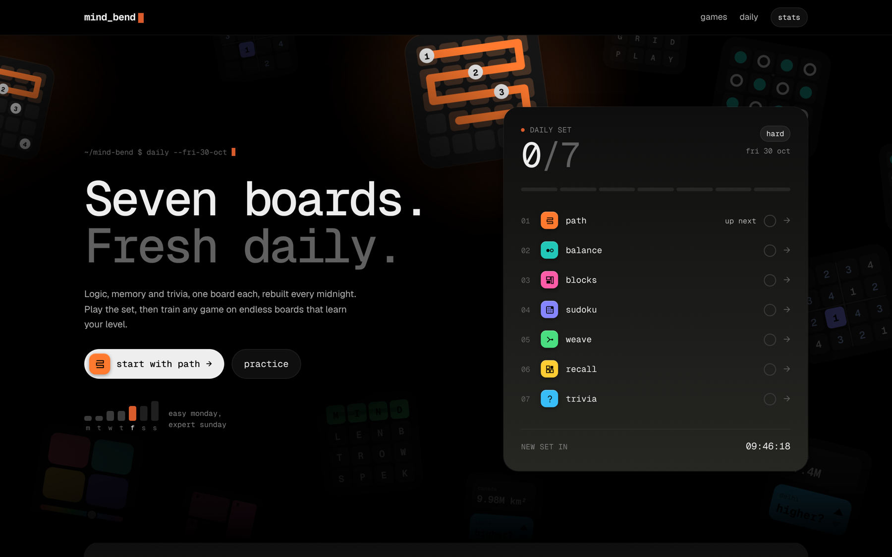
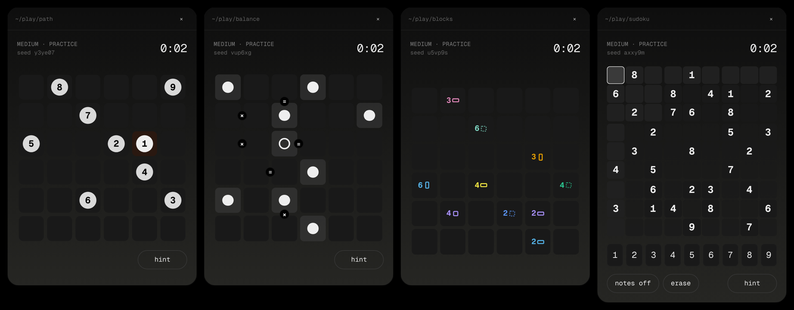
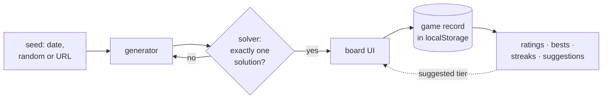

<div align="center">

# mind_bend

Logic puzzles, memory games and trivia in one app.<br>
Daily challenges, infinite practice, difficulty that adapts to you.

[](https://github.com/Mavett24/mind-bend/actions/workflows/ci.yml)
[](https://mind-bend.vercel.app)


[](LICENSE)

**[Play it](https://mind-bend.vercel.app)** · [Design system](DESIGN.md) · [Decision log](docs/DECISIONS.md) · [Changelog](CHANGELOG.md)



</div>

## Seven games

| Game | Skill | Scored by | Inspired by |
|------|-------|-----------|-------------|
| **path** | Route planning | time | LinkedIn Zip |
| **balance** | Binary deduction | time | LinkedIn Tango |
| **blocks** | Spatial partitioning | time | LinkedIn Patches |
| **sudoku** | Number logic | time | LinkedIn Mini Sudoku |
| **weave** | Word finding | time | LinkedIn Wend |
| **recall** | Visual working memory | points /10 | Dialed |
| **trivia** | Knowledge and estimation | points /10 | Lessgames |

Every game has four tiers (easy to expert), a skippable how-to-play screen and hints with a cooldown on the logic games. Balance and sudoku hints also explain the rule behind the move.



## How it works

**Every board comes from a seed.** The daily set uses the date, practice uses a random seed, and a challenge link carries the seed in the URL (`/play/path?t=hard&s=k3f9x2`), so anyone who opens it gets the exact same board. Seeds feed a hand-written RNG (cyrb53 hash), never `Math.random`.

**Every logic board is proven unique.** Generators are paired with solvers that reject any board with more than one solution or one that needs guessing. Sudoku goes further: a technique-based solver (singles, pointing, claiming, pairs, triples, X-wing) grades each board, so hard and expert can never be finished with singles alone.

**Scores live in your browser.** Each finished or abandoned game is one record. Ratings (Elo, one per game), bests, streaks, solve rates and the training calendar are all derived from that history, with no backend and no account. A transfer code moves history between devices and merges without duplicates.



## Architecture

```
src/
├── app/            routes: home, /play/[game], /stats
├── components/     shared UI: start card, game tiles, pickers, charts
├── engine/         pure TypeScript: RNG, seeds, tiers, rating, history, storage
├── lib/            client hooks: history store, profile, motion tokens
└── games/
    └── <game>/
        ├── engine.ts       generator + solver, no React or DOM
        ├── engine.test.ts  multi-seed uniqueness tests per tier
        └── Board.tsx       the playable board
```

The split is strict: anything that decides what a board *is* lives in pure TypeScript and is unit tested, while React only renders and handles input. That is what makes the uniqueness guarantees testable at scale.

## Testing

Over 100 tests across the engine and all seven games. Each generator test runs many seeds per tier and asserts the result:

| Game | Boards checked per run | Guarantee |
|------|-----------------------:|-----------|
| path | 240 | one solution |
| balance | 400 | one solution, solvable without guessing; hints alone solve it |
| blocks | 400 | one solution (exact-cover solver) |
| sudoku | 170 | unique, logic-solvable, graded by technique |
| weave | 400 | words tile every letter exactly once |

Recall's colour scoring (CIEDE2000) is checked against published reference pairs, and the rating, history and transfer logic have their own suites. CI runs lint, typecheck, tests and a production build on every push and pull request.

## Getting started

Requires Node 20.9+ (`.nvmrc` pins 22).

```bash
npm install
npm run dev        # http://localhost:3000
```

| Script | What it does |
|--------|--------------|
| `npm run dev` | Dev server |
| `npm test` | Engine and generator tests (Vitest) |
| `npm run lint` | ESLint |
| `npm run typecheck` | Generates Next route types, then `tsc --noEmit` |
| `npm run check` | Lint, typecheck and tests in one go |
| `npm run build` | Production build |

## Docs

| File | What it holds |
|------|---------------|
| [`docs/PRODUCT.md`](docs/PRODUCT.md) | Brief, principles, modes, scope |
| [`DESIGN.md`](DESIGN.md) | Design system: tokens, components, motion, voice |
| [`docs/games/`](docs/games/) | One spec per game: rules, generation, difficulty |
| [`docs/DECISIONS.md`](docs/DECISIONS.md) | Every product and design decision, with the reason and the trade-off |
| [`docs/ROADMAP.md`](docs/ROADMAP.md) | Phases and what ships in each |
| [`CHANGELOG.md`](CHANGELOG.md) | What changed, release by release |

## Stack

[Next.js 16](https://nextjs.org) · [React 19](https://react.dev) · [TypeScript](https://www.typescriptlang.org) · [Tailwind CSS v4](https://tailwindcss.com) · [Motion](https://motion.dev) · [Vitest](https://vitest.dev) · [Vercel](https://vercel.com)

## Content and licence

Code is [MIT](LICENSE). Word lists and trivia data are built by `scripts/build-data.mjs` into `public/data/` from openly licensed sources: SCOWL word lists, OpenTriviaQA questions (CC BY-SA 4.0, so the question files are shared under the same licence), World Bank data (CC BY 4.0), mledoze/countries (ODbL), GeoNames (CC BY 4.0) and the LDNOOBW offensive-word list (CC BY 4.0). Details in [`scripts/DATA_SOURCES.md`](scripts/DATA_SOURCES.md).

Game mechanics are inspired by LinkedIn Games (Zip, Tango, Patches, Mini Sudoku, Wend), Dialed and Lessgames. All names, visuals, puzzles and code here are original.

---

<div align="center">
<sub>Designed and built by <a href="https://matteofavetta.com">Matteo Favetta</a></sub>
</div>
